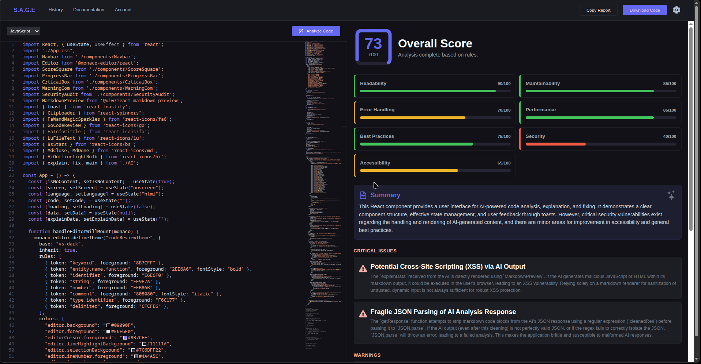
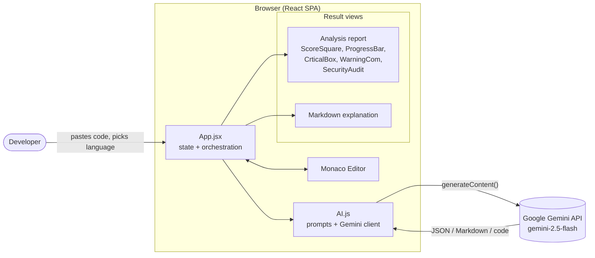
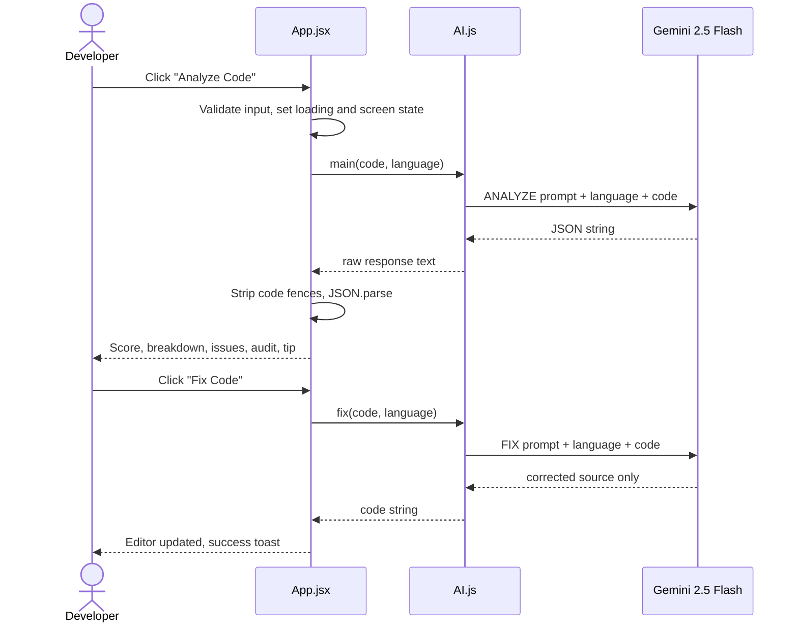

<div align="center">

# S.A.G.E — AI Code Reviewer

**Paste code. Get a scored review, a security audit, a plain-English explanation, and an auto-fixed version — in seconds.**


</div>

<div align="center">



<sub>S.A.G.E reviewing its own source code: overall score, category breakdown, summary, and critical issues.</sub>

</div>

---

## Table of Contents

1. [Overview](#overview)
2. [Features](#features)
3. [How It Works](#how-it-works)
4. [Architecture](#architecture)
5. [Tech Stack](#tech-stack)
6. [Project Structure](#project-structure)
7. [Getting Started](#getting-started)
8. [Configuration](#configuration)
9. [Usage Guide](#usage-guide)
10. [Analysis Report Schema](#analysis-report-schema)
11. [Security Considerations](#security-considerations)
12. [Known Limitations](#known-limitations)
13. [Roadmap](#roadmap)
14. [Contributing](#contributing)
15. [Author](#author)

---

## Overview

**S.A.G.E** is a browser-based AI code review tool. Developers paste a snippet into a Monaco-powered editor, pick a language, and S.A.G.E sends it to Google's Gemini model with purpose-built system prompts. Depending on the action chosen, it returns one of three things:

| Action | Output |
|---|---|
| **Analyze Code** | A structured review: overall score, per-category score bars, summary, critical issues, line-referenced warnings, security metrics, compliance checklist, and a pro tip |
| **Explain Code** | A beginner-friendly Markdown walkthrough whose depth adapts to the size and complexity of the code |
| **Fix Code** | A corrected, improved version of the code, written straight back into the editor |

The application is a pure front-end single-page app. There is no custom backend, database, or user account system.

---

## Features

### Code Analysis
- **Overall score (0–100)** rendered as an animated square gauge.
- **Dynamic score breakdown.** Categories such as Readability, Performance, Security, Maintainability, Error Handling, Accessibility, and Type Safety are chosen by the model to fit the code, not forced from a fixed list.
- **Colour-coded progress bars:** red below 50, amber from 50 to 74, green from 75 up.
- **Critical issues** with an icon, title, and description, shown only when something is genuinely serious.
- **Warnings** for minor and medium issues, tagged with line numbers where possible.
- **Security audit tiles** with metrics generated per snippet (for example OWASP score, injection risk, XSS protection, secret exposure risk).
- **Compliance checklist** of pass/fail best-practice checks.
- **Pro tip** that teaches one real-world engineering or security concept.

### Explain Code
- Markdown output (headings, bullets, tables, code blocks) rendered in-app.
- Short snippets get a short explanation. Larger code gets sections such as Overview, Architecture, Execution Flow, and Security Considerations.
- Written for learners: covers both *what* the code does and *how* it works.

### Fix Code
- Returns **code only**: no commentary and no markdown fences.
- Fix priority order: syntax errors, runtime errors, security issues, logic errors, performance, code quality, readability.
- Preserves original behaviour unless a bug or vulnerability requires a change.

### Editor and Workflow
- **Monaco Editor** (the engine behind VS Code) with a custom dark theme and syntax highlighting.
- **38 selectable languages**, from HTML, JavaScript, TypeScript, Python, Java, C/C++, Go, and Rust to SQL, Bash, GraphQL, YAML, and COBOL.
- **Copy Report** copies the score and summary to the clipboard.
- **Download Code** saves the current editor contents as a file.
- Toast notifications for validation, success, and error states, plus loading spinners per action.

---

## How It Works

1. The user pastes or types code and selects a language.
2. The user clicks **Analyze Code**, **Explain Code**, or **Fix Code**.
3. `src/AI.js` concatenates the matching system prompt, the language, and the code into a single prompt.
4. The prompt is sent to **Gemini 2.5 Flash** through the `@google/genai` SDK.
5. The response is handled according to the action:
   - **Analyze:** the response is cleaned of any stray ` ```json ` fences, parsed as JSON, and rendered through the report components.
   - **Explain:** the Markdown is rendered with `@uiw/react-markdown-preview`.
   - **Fix:** the returned code replaces the editor contents.

Each action has its own prompt with strict output rules (raw JSON only, Markdown only, or code only). This keeps responses machine-parseable and predictable.

---

## Architecture

### System Overview



### Request Flow



### Design Decisions

| Decision | Rationale |
|---|---|
| **Three separate prompts**, one per action | Each output format (JSON, Markdown, raw code) needs different constraints. Splitting them keeps each prompt short and strict. |
| **Model-driven categories** | Forcing "Security" or "Performance" scores onto a CSS file produces noise. The prompt tells the model to emit only relevant categories. |
| **Defensive JSON parsing** | Models sometimes wrap JSON in fences despite instructions. The client strips fences before parsing and surfaces a toast on failure. |
| **Presentational components** | Every report widget is a small stateless component that receives plain props, so each is easy to restyle or replace. |
| **Client-only architecture** | Zero infrastructure and instant deployment as a static site. See [Security Considerations](#security-considerations) for the trade-off. |

### State Model (`App.jsx`)

| State | Purpose |
|---|---|
| `code` | Current editor contents |
| `language` | Selected language (drives Monaco highlighting and the prompt) |
| `screen` | Active result view: `noscreen`, `analyze`, `explain`, or `fix` |
| `loading` | Disables actions and shows the spinner on the active button |
| `data` | Parsed analysis report |
| `explainData` | Markdown explanation string |
| `isNoContent` | Controls the empty-state placeholder |

---

## Tech Stack

| Layer | Technology |
|---|---|
| UI framework | React 19 |
| Build tool | Vite 8 with `@vitejs/plugin-react` |
| Styling | Tailwind CSS 3, PostCSS, Autoprefixer, custom CSS |
| Code editor | `@monaco-editor/react` (Monaco) |
| AI | `@google/genai` SDK, model `gemini-2.5-flash` |
| Markdown rendering | `@uiw/react-markdown-preview` |
| Icons | `react-icons` (Font Awesome, GitHub Octicons, Lucide, Bootstrap, Material, Heroicons, Ionicons) |
| Feedback UI | `react-toastify`, `react-spinners` |
| Linting | ESLint 10, `eslint-plugin-react-hooks`, `eslint-plugin-react-refresh` |

---

## Project Structure

```
S.A.G.E-AI-CODE-REVIEWER/
├── public/
│   ├── favicon.svg
│   └── icons.svg
├── src/
│   ├── components/
│   │   ├── Navbar.jsx          # Top bar: branding, nav links, Copy Report, Download Code
│   │   ├── ScoreSquare.jsx     # Animated square SVG gauge for the overall score
│   │   ├── ProgressBar.jsx     # Per-category score bar (red / amber / green)
│   │   ├── CrticalBox.jsx      # Critical issue card with a dynamic Font Awesome icon
│   │   ├── WarningCom.jsx      # Warning row with a line-number badge
│   │   └── SecurityAudit.jsx   # Security metric tile
│   ├── AI.js                   # System prompts + Gemini client (analyze / explain / fix)
│   ├── App.jsx                 # Main layout, state, handlers, Monaco theme
│   ├── App.css                 # Component styles
│   ├── index.css               # Tailwind directives and global styles
│   └── main.jsx                # React entry point and ToastContainer
├── index.html                  # Vite HTML entry
├── vite.config.js
├── tailwind.config.js
├── postcss.config.js
├── eslint.config.js
└── package.json
```

---

## Getting Started

### Prerequisites

- **Node.js** current LTS (20.19 or newer recommended) and **npm**
- A **Google Gemini API key**, available free from [Google AI Studio](https://aistudio.google.com/apikey)

### Installation

```bash
# 1. Clone the repository
git clone https://github.com/sriyansh-dev/S.A.G.E-AI-CODE-REVIEWER.git
cd S.A.G.E-AI-CODE-REVIEWER

# 2. Install dependencies
npm install

# 3. Create your environment file
echo "VITE_GEMINI_API_KEY=your_api_key_here" > .env

# 4. Start the dev server
npm run dev
```

Open the local URL printed in the terminal (Vite defaults to `http://localhost:5173`).

### Available Scripts

| Command | Description |
|---|---|
| `npm run dev` | Start the Vite dev server with hot module replacement |
| `npm run build` | Create an optimized production build in `dist/` |
| `npm run preview` | Serve the production build locally |
| `npm run lint` | Run ESLint across the project |

---

## Configuration

| Variable | Required | Description |
|---|---|---|
| `VITE_GEMINI_API_KEY` | Yes | Google Gemini API key, read in `src/AI.js` via `import.meta.env` |

`.env` is listed in `.gitignore`, so your key will not be committed. Restart the dev server after changing environment variables.

To change the model, edit the `model` field in the three `generateContent` calls in `src/AI.js` (currently `gemini-2.5-flash`).

---

## Usage Guide

1. **Choose a language** from the dropdown above the editor.
2. **Paste or write code** in the editor.
3. Choose an action:
   - **Analyze Code** (top right of the editor panel) fills the right panel with the full report.
   - **Explain Code** renders a Markdown explanation in the right panel.
   - **Fix Code** replaces the editor contents with the corrected version. Use the editor's undo (`Ctrl/Cmd + Z`) to revert.
4. Use **Copy Report** or **Download Code** in the navbar to export results.

> **Tip:** Run *Analyze* first to see what is wrong, then *Fix Code*, then *Analyze* again to confirm the score improved.

---

## Analysis Report Schema

The Analyze prompt instructs the model to return exactly this structure, which the UI consumes directly:

```jsonc
{
  "overallScore": 82,                         // 0–100
  "scoreBreakdown": [                         // categories are chosen dynamically
    { "name": "Readability", "score": 90 }
  ],
  "summary": "Concise professional summary.",
  "critical": [                               // empty array when none
    { "icon": "FaExclamationTriangle", "title": "…", "description": "…" }
  ],
  "warnings": [
    { "title": "…", "line": "24" }
  ],
  "securityAudit": {
    "metrics": [ { "name": "Injection Risk", "value": "Low" } ]
  },
  "complianceStandards": [
    { "name": "Error Handling Present", "check": "yes" }   // "yes" | "no"
  ],
  "proTip": "Maximum two sentences.",
  "needToFix": true                           // true for critical / security / syntax / production-risk issues
}
```

Sections that do not apply to the submitted code are returned empty and are hidden in the UI.

---

## Security Considerations

> **Important: read before deploying publicly.**

- **The API key is exposed to the browser.** Vite inlines every `VITE_*` variable into the client bundle, so anyone who can load a deployed build can extract the key. This is fine for local development and personal use.
- **For a public deployment**, move the Gemini call behind a small backend or serverless function (for example Vercel Functions, Cloudflare Workers, or an Express server) that holds the key server-side, and have the front end call that endpoint instead.
- **Restrict and rotate your key** in Google AI Studio or Google Cloud Console, and set quotas to cap abuse.
- **Code you paste is sent to Google's Gemini API.** Do not submit proprietary code, credentials, or secrets unless that is acceptable under your organization's data policies.
- **AI output is advisory.** Review fixes before using them in production. Models can miss vulnerabilities or introduce new bugs.

---

## Known Limitations

- **Compliance checklist icons:** the prompt returns each item as `check: "yes" | "no"`, but `App.jsx` reads `item.passed`, so every item currently renders as a failed (red ✗) check. Aligning the field name fixes this.
- **Download file extension:** `Download Code` names the file `sage-code.<selector value>`, so languages like Python download as `.python` instead of `.py`.
- **`needToFix` is returned but not yet used** to drive any UI (for example highlighting the Fix button).
- **Navbar placeholders:** *History*, *Documentation*, *Account*, and the settings icon are not wired up yet.
- **Large inputs:** the entire snippet is sent in a single prompt, so very large files may exceed model limits.
- **No automated tests** are included yet.

---

## Roadmap

- [ ] Fix compliance checklist field mapping and download file extensions
- [ ] Move the Gemini call behind a serverless proxy
- [ ] Analysis history with local persistence
- [ ] Use `needToFix` to guide the user toward the Fix action
- [ ] Side-by-side diff view for *Fix Code*
- [ ] Inline editor markers for warnings using the reported line numbers
- [ ] Full-report export (Markdown / PDF)
- [ ] Model selection and settings panel
- [ ] File upload and multi-file review
- [ ] Unit and component tests

---

## Contributing

Contributions, issues, and feature requests are welcome.

1. Fork the repository
2. Create a feature branch: `git checkout -b feature/your-feature`
3. Commit your changes: `git commit -m "Add your feature"`<div align="center">

# S.A.G.E — AI Code Reviewer

**Paste code. Get a scored review, a security audit, a plain-English explanation, and an auto-fixed version — in seconds.**


</div>

<div align="center">


<sub>S.A.G.E reviewing its own source code: overall score, category breakdown, summary, and critical issues.</sub>

</div>

---

## Table of Contents

1. [Overview](#overview)
2. [Features](#features)
3. [How It Works](#how-it-works)
4. [Architecture](#architecture)
5. [Tech Stack](#tech-stack)
6. [Project Structure](#project-structure)
7. [Getting Started](#getting-started)
8. [Configuration](#configuration)
9. [Usage Guide](#usage-guide)
10. [Analysis Report Schema](#analysis-report-schema)
11. [Security Considerations](#security-considerations)
12. [Known Limitations](#known-limitations)
13. [Roadmap](#roadmap)
14. [Contributing](#contributing)
15. [Author](#author)

---

## Overview

**S.A.G.E** is a browser-based AI code review tool. Developers paste a snippet into a Monaco-powered editor, pick a language, and S.A.G.E sends it to Google's Gemini model with purpose-built system prompts. Depending on the action chosen, it returns one of three things:

| Action | Output |
|---|---|
| **Analyze Code** | A structured review: overall score, per-category score bars, summary, critical issues, line-referenced warnings, security metrics, compliance checklist, and a pro tip |
| **Explain Code** | A beginner-friendly Markdown walkthrough whose depth adapts to the size and complexity of the code |
| **Fix Code** | A corrected, improved version of the code, written straight back into the editor |

The application is a pure front-end single-page app. There is no custom backend, database, or user account system.

---

## Features

### Code Analysis
- **Overall score (0–100)** rendered as an animated square gauge.
- **Dynamic score breakdown.** Categories such as Readability, Performance, Security, Maintainability, Error Handling, Accessibility, and Type Safety are chosen by the model to fit the code, not forced from a fixed list.
- **Colour-coded progress bars:** red below 50, amber from 50 to 74, green from 75 up.
- **Critical issues** with an icon, title, and description, shown only when something is genuinely serious.
- **Warnings** for minor and medium issues, tagged with line numbers where possible.
- **Security audit tiles** with metrics generated per snippet (for example OWASP score, injection risk, XSS protection, secret exposure risk).
- **Compliance checklist** of pass/fail best-practice checks.
- **Pro tip** that teaches one real-world engineering or security concept.

### Explain Code
- Markdown output (headings, bullets, tables, code blocks) rendered in-app.
- Short snippets get a short explanation. Larger code gets sections such as Overview, Architecture, Execution Flow, and Security Considerations.
- Written for learners: covers both *what* the code does and *how* it works.

### Fix Code
- Returns **code only**: no commentary and no markdown fences.
- Fix priority order: syntax errors, runtime errors, security issues, logic errors, performance, code quality, readability.
- Preserves original behaviour unless a bug or vulnerability requires a change.

### Editor and Workflow
- **Monaco Editor** (the engine behind VS Code) with a custom dark theme and syntax highlighting.
- **38 selectable languages**, from HTML, JavaScript, TypeScript, Python, Java, C/C++, Go, and Rust to SQL, Bash, GraphQL, YAML, and COBOL.
- **Copy Report** copies the score and summary to the clipboard.
- **Download Code** saves the current editor contents as a file.
- Toast notifications for validation, success, and error states, plus loading spinners per action.

---

## How It Works

1. The user pastes or types code and selects a language.
2. The user clicks **Analyze Code**, **Explain Code**, or **Fix Code**.
3. `src/AI.js` concatenates the matching system prompt, the language, and the code into a single prompt.
4. The prompt is sent to **Gemini 2.5 Flash** through the `@google/genai` SDK.
5. The response is handled according to the action:
   - **Analyze:** the response is cleaned of any stray ` ```json ` fences, parsed as JSON, and rendered through the report components.
   - **Explain:** the Markdown is rendered with `@uiw/react-markdown-preview`.
   - **Fix:** the returned code replaces the editor contents.

Each action has its own prompt with strict output rules (raw JSON only, Markdown only, or code only). This keeps responses machine-parseable and predictable.

---

## Architecture

### System Overview


### Request Flow


### Design Decisions

| Decision | Rationale |
|---|---|
| **Three separate prompts**, one per action | Each output format (JSON, Markdown, raw code) needs different constraints. Splitting them keeps each prompt short and strict. |
| **Model-driven categories** | Forcing "Security" or "Performance" scores onto a CSS file produces noise. The prompt tells the model to emit only relevant categories. |
| **Defensive JSON parsing** | Models sometimes wrap JSON in fences despite instructions. The client strips fences before parsing and surfaces a toast on failure. |
| **Presentational components** | Every report widget is a small stateless component that receives plain props, so each is easy to restyle or replace. |
| **Client-only architecture** | Zero infrastructure and instant deployment as a static site. See [Security Considerations](#security-considerations) for the trade-off. |

### State Model (`App.jsx`)

| State | Purpose |
|---|---|
| `code` | Current editor contents |
| `language` | Selected language (drives Monaco highlighting and the prompt) |
| `screen` | Active result view: `noscreen`, `analyze`, `explain`, or `fix` |
| `loading` | Disables actions and shows the spinner on the active button |
| `data` | Parsed analysis report |
| `explainData` | Markdown explanation string |
| `isNoContent` | Controls the empty-state placeholder |

---

## Tech Stack

| Layer | Technology |
|---|---|
| UI framework | React 19 |
| Build tool | Vite 8 with `@vitejs/plugin-react` |
| Styling | Tailwind CSS 3, PostCSS, Autoprefixer, custom CSS |
| Code editor | `@monaco-editor/react` (Monaco) |
| AI | `@google/genai` SDK, model `gemini-2.5-flash` |
| Markdown rendering | `@uiw/react-markdown-preview` |
| Icons | `react-icons` (Font Awesome, GitHub Octicons, Lucide, Bootstrap, Material, Heroicons, Ionicons) |
| Feedback UI | `react-toastify`, `react-spinners` |
| Linting | ESLint 10, `eslint-plugin-react-hooks`, `eslint-plugin-react-refresh` |

---

## Project Structure

```
S.A.G.E-AI-CODE-REVIEWER/
├── public/
│   ├── favicon.svg
│   └── icons.svg
├── src/
│   ├── components/
│   │   ├── Navbar.jsx          # Top bar: branding, nav links, Copy Report, Download Code
│   │   ├── ScoreSquare.jsx     # Animated square SVG gauge for the overall score
│   │   ├── ProgressBar.jsx     # Per-category score bar (red / amber / green)
│   │   ├── CrticalBox.jsx      # Critical issue card with a dynamic Font Awesome icon
│   │   ├── WarningCom.jsx      # Warning row with a line-number badge
│   │   └── SecurityAudit.jsx   # Security metric tile
│   ├── AI.js                   # System prompts + Gemini client (analyze / explain / fix)
│   ├── App.jsx                 # Main layout, state, handlers, Monaco theme
│   ├── App.css                 # Component styles
│   ├── index.css               # Tailwind directives and global styles
│   └── main.jsx                # React entry point and ToastContainer
├── index.html                  # Vite HTML entry
├── vite.config.js
├── tailwind.config.js
├── postcss.config.js
├── eslint.config.js
└── package.json
```

---

## Getting Started

### Prerequisites

- **Node.js** current LTS (20.19 or newer recommended) and **npm**
- A **Google Gemini API key**, available free from [Google AI Studio](https://aistudio.google.com/apikey)

### Installation

```bash
# 1. Clone the repository
git clone https://github.com/sriyansh-dev/S.A.G.E-AI-CODE-REVIEWER.git
cd S.A.G.E-AI-CODE-REVIEWER

# 2. Install dependencies
npm install

# 3. Create your environment file
echo "VITE_GEMINI_API_KEY=your_api_key_here" > .env

# 4. Start the dev server
npm run dev
```

Open the local URL printed in the terminal (Vite defaults to `http://localhost:5173`).

### Available Scripts

| Command | Description |
|---|---|
| `npm run dev` | Start the Vite dev server with hot module replacement |
| `npm run build` | Create an optimized production build in `dist/` |
| `npm run preview` | Serve the production build locally |
| `npm run lint` | Run ESLint across the project |

---

## Configuration

| Variable | Required | Description |
|---|---|---|
| `VITE_GEMINI_API_KEY` | Yes | Google Gemini API key, read in `src/AI.js` via `import.meta.env` |

`.env` is listed in `.gitignore`, so your key will not be committed. Restart the dev server after changing environment variables.

To change the model, edit the `model` field in the three `generateContent` calls in `src/AI.js` (currently `gemini-2.5-flash`).

---

## Usage Guide

1. **Choose a language** from the dropdown above the editor.
2. **Paste or write code** in the editor.
3. Choose an action:
   - **Analyze Code** (top right of the editor panel) fills the right panel with the full report.
   - **Explain Code** renders a Markdown explanation in the right panel.
   - **Fix Code** replaces the editor contents with the corrected version. Use the editor's undo (`Ctrl/Cmd + Z`) to revert.
4. Use **Copy Report** or **Download Code** in the navbar to export results.

> **Tip:** Run *Analyze* first to see what is wrong, then *Fix Code*, then *Analyze* again to confirm the score improved.

---

## Analysis Report Schema

The Analyze prompt instructs the model to return exactly this structure, which the UI consumes directly:

```jsonc
{
  "overallScore": 82,                         // 0–100
  "scoreBreakdown": [                         // categories are chosen dynamically
    { "name": "Readability", "score": 90 }
  ],
  "summary": "Concise professional summary.",
  "critical": [                               // empty array when none
    { "icon": "FaExclamationTriangle", "title": "…", "description": "…" }
  ],
  "warnings": [
    { "title": "…", "line": "24" }
  ],
  "securityAudit": {
    "metrics": [ { "name": "Injection Risk", "value": "Low" } ]
  },
  "complianceStandards": [
    { "name": "Error Handling Present", "check": "yes" }   // "yes" | "no"
  ],
  "proTip": "Maximum two sentences.",
  "needToFix": true                           // true for critical / security / syntax / production-risk issues
}
```

Sections that do not apply to the submitted code are returned empty and are hidden in the UI.

---

## Security Considerations

> **Important: read before deploying publicly.**

- **The API key is exposed to the browser.** Vite inlines every `VITE_*` variable into the client bundle, so anyone who can load a deployed build can extract the key. This is fine for local development and personal use.
- **For a public deployment**, move the Gemini call behind a small backend or serverless function (for example Vercel Functions, Cloudflare Workers, or an Express server) that holds the key server-side, and have the front end call that endpoint instead.
- **Restrict and rotate your key** in Google AI Studio or Google Cloud Console, and set quotas to cap abuse.
- **Code you paste is sent to Google's Gemini API.** Do not submit proprietary code, credentials, or secrets unless that is acceptable under your organization's data policies.
- **AI output is advisory.** Review fixes before using them in production. Models can miss vulnerabilities or introduce new bugs.

---

## Known Limitations

- **Compliance checklist icons:** the prompt returns each item as `check: "yes" | "no"`, but `App.jsx` reads `item.passed`, so every item currently renders as a failed (red ✗) check. Aligning the field name fixes this.
- **Download file extension:** `Download Code` names the file `sage-code.<selector value>`, so languages like Python download as `.python` instead of `.py`.
- **`needToFix` is returned but not yet used** to drive any UI (for example highlighting the Fix button).
- **Navbar placeholders:** *History*, *Documentation*, *Account*, and the settings icon are not wired up yet.
- **Large inputs:** the entire snippet is sent in a single prompt, so very large files may exceed model limits.
- **No automated tests** are included yet.

---

## Roadmap

- [ ] Fix compliance checklist field mapping and download file extensions
- [ ] Move the Gemini call behind a serverless proxy
- [ ] Analysis history with local persistence
- [ ] Use `needToFix` to guide the user toward the Fix action
- [ ] Side-by-side diff view for *Fix Code*
- [ ] Inline editor markers for warnings using the reported line numbers
- [ ] Full-report export (Markdown / PDF)
- [ ] Model selection and settings panel
- [ ] File upload and multi-file review
- [ ] Unit and component tests

---

## Contributing

Contributions, issues, and feature requests are welcome.

1. Fork the repository
2. Create a feature branch: `git checkout -b feature/your-feature`
3. Commit your changes: `git commit -m "Add your feature"`
4. Push the branch: `git push origin feature/your-feature`
5. Open a Pull Request

Please run `npm run lint` before submitting.

---

## Author

**Sriyansh Raj**
GitHub: [@sriyansh-dev](https://github.com/sriyansh-dev)

---

<div align="center">

Built with React, Vite, and Google Gemini.

</div>
4. Push the branch: `git push origin feature/your-feature`
5. Open a Pull Request

Please run `npm run lint` before submitting.

---

## Author

**Sriyansh Raj**
GitHub: [@sriyansh-dev](https://github.com/sriyansh-dev)

---

<div align="center">

Built with React, Vite, and Google Gemini.

</div>
